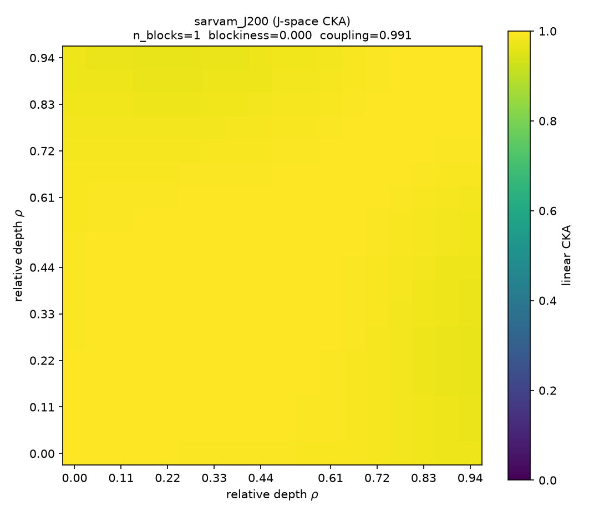

# Sarvam-30B workspace lenses: what language does it think in?

> This is the **code** folder of the project. The full write-up (methods, engineering log, results, costs,
> reproduction, limitations) is in [`../docs/`](../docs/), and run outputs are in [`../results/`](../results/).


This project fits **J-Lens, R-Lens and J++ Lens** readouts on `sarvamai/sarvam-30b`. It then
asks which language the model's middle layers pass through when it translates between
Indian languages: English, Hindi, or the languages themselves.

It builds on the J++ code release ([safety-research/jpp_lens](https://github.com/safety-research/jpp_lens),
tested at commit `d7efc0d`, 2026-10-17). That release implements all three lenses. This folder adds
what Sarvam needs and the pivot-language experiment.

| File | What it does |
|---|---|
| `sarvam_support.py` | Loads Sarvam's pinned Hub code (rev `071ae95`) without `trust_remote_code`, applies a transformers-5 shim, prepends BOS, and implements **Sarvam-specific LRP rules** |
| `run_jpp.py` | `jpp_cli.py` with Sarvam support, Indic fit corpora (`JPP_FIT_PROMPTS_JSON`), and two extra stages: `prepare-evals` and `grade` |
| `build_corpus.py` | Language-interleaved Wikipedia prompt pool for fitting |
| `pivot_experiment.py` | The experiment: per-layer, per-language readouts with token controls; writes CSVs and plots |
| `data/concepts.tsv` | 32 concepts × 10 language columns (en, hi, romanized hi, bn, ta, te, mr, gu, kn, ml) |
| `smoke_test.py` | End-to-end check on a tiny random Sarvam (runs on CPU). **Run it first on the GPU box** |
| `reader_questions.py` | Reader-question experiments (docs/09): chat-template pivot, sentence translation, clozes, English-collapse errors, thinking mode |
| `token_split.py` | Free re-analysis of the pivots by token count (is English just easier to read?) |
| `neuron_experiment.py` | MoE expert routing by language and concept (bare words + translation prompts), and layer-0 cross-script concept neurons with a shuffled-label null |
| `languages.py` | Registry of 28 languages (22 scheduled + en, hi_latn, zh, ja, ru, ar): self-name labels, families, script ranges, native digits, translator codes |
| `batch_gen.py` | Batched greedy decoding (left-padded, masked, KV-cached); `check()` compares it with lone decoding |
| `batch_probe.py` | Batched vs lone on the tiny models (fp32/bf16, 2 GPUs): a padding bug or bf16 batch-variance? |
| `build_xling_sets.py`, `translate.py`, `modal_translate.py`, `check_translations.py` | The cross-lingual prompt sets (XSTest, MGSM, ARC, MMLU, Dolly), their IndicTrans2/NLLB translation on Modal, and the translation QA |
| `newlang_experiment.py` | Doc 11: the 22 languages in the word pivot, plus the English ablation for the new languages |
| `domain_experiment.py` | Doc 12: script profile by prompt domain, native-digit arithmetic, MGSM, thinking-on reasoning script |
| `quant_check.py` | Doc 14: the published pivot's readouts with a bf16 vs an fp32 head |
| `routing_ablation.py` | Doc 09 §11: expert routing under the English ablation vs the control (stage `routing_ablation.english`; `--analyze` offline) |
| `concept_geometry_controls.py` | Doc 15: centroid variants and hub retrieval on the saved concept vectors (CPU; `newlang_experiment.geometry` collects them). Writes `geometry_controls_v2.json`; `--self-check` tests the script-overlap rule |
| `post1_experiment.py` | Doc 17: every language and two English neighbours as pivot roles (`roles`); joint, all-position, number-word and Chinese ablations and the push curve with size-matched random controls (`joint`, `positions`, `digits`, `zh`/`zh2`, `push`); writer attribution (`writers`); MGSM thinking language and the hint test run to completion with a continuous-batching sampler (`think`, `hint`; on the 105B a folded-MLA decode step and in-place forced answers, gated by `decode_check`) |
| `post1_check_decode.py` | Doc 17: `generate_cb` vs lone greedy decoding, in-place vs re-read forced answers and deadline forcing, token for token on the tiny 30B / 105B (CPU, or 2 GPUs via `modal_app.py --step post1-decode-2gpu`) |
| `check_review_fixes.py` | CPU regression checks (no model) for the 2026-10-20 outside-review fixes: script-overlap geometry control, clustered bootstraps, tied neuron ranks, translation fingerprints, the J++ held-out guard, number parsing, letter-only script shares. Re-analyses at $0: `concept_geometry_controls.py` (writes `geometry_controls_v2.json`), `routing_ablation.py --analyze` (`routing_ablation_summary_v2.json`), `neuron_experiment.py --reanalyze <run> --suffix _v2`, `domain_experiment.py resummarize <run>` and `hint-regrade <folder>` (`*_v2` files), `translate.py verify` (the saved `data/xling` sets against their source) |
| `smoke_test_mla.py` | The same for the Sarvam-105B path (tiny random `SarvamMLAForCausalLM`; `--two-gpu` splits it over 2 GPUs) |
| `modal_app.py`, `modal_pilot.py` | Run everything on Modal under a hard cost cap: bf16 weight conversion, a CPU check in the same image, and the budgeted H200 pilot |

## Results (2026-10-18, ~$29 on Modal)

### 1. Sarvam-30B translates between Indian languages through English (and, weakly, Hindi)

5-shot word translation, 32 concepts, 10 Indic→Indic pairs (256 items Sarvam got right; 382/448 over all
14 pairs). Four lenses: logit, **J-lens (200 WikiText prompts)**, R-lens (25, LRP `r+moe`), J++ (25,
weights learned without the English-target multilingual items).

| Top-10 rate, Indic→Indic, J-lens | L13 | L14 | L15 | L16 | L17 |
|---|---|---|---|---|---|
| English translation of the word | 80% | **98%** | **98%** | **99%** | 86% |
| English word of a *different* concept (control) | 0% | 0% | 0% | 0% | 0% |
| Hindi translation | 42% | 60% | 55% | 68% | 62% |
| Hindi word of a different concept (control) | 0% | 0% | 0% | 0% | 0% |
| Target word (the answer) | 11% | 22% | 27% | 42% | 84% |

- **English dominates layers 14–16** (P(English) up to 0.74 under the J-lens) in every pair: Dravidian↔Dravidian,
  Indo-Aryan↔Indo-Aryan, across families, with no English in the prompt. All four lenses agree.
- **Hindi is a genuine, concept-specific secondary latent:** often in the top 10 (41–83% at L14–16 depending on the lens), but with ≤3% of the
  probability. The shuffled control rules out generic Devanagari noise.
- **Nothing is readable before layer 11** under any lens.

### 2. The English representation is causally used, but it isn't a bottleneck

Removing the English word's lens directions from the final position's residual at layers 13–16
(272 correctly translated items):

| Removed | ΔP(target), J-lens dirs | ΔP(target), R-lens dirs |
|---|---|---|
| English word, layers 13–16 | **−5.7 pts** (95% CI 4.3–7.1) | **−6.7** (5.1–8.5) |
| Different concept's English word, same layers | −0.4 (≈0) | −1.5 |
| English word, layers 5–8 | −0.3 (≈0) | −1.4 |

Concept-specific and depth-specific, so English is *used*. But 95% of translations survive, so it is one route among several.

### 2b. Follow-ups: Hindi ablation, concept swap, sentences (~$1.30)

- **Hindi ablation:** removing the Hindi word's directions at layers 13–16 costs **−4.4 pts** (CI 3.1–5.8);
  a different concept's Hindi costs −0.4, and early layers −0.2. Hindi-minus-control is **4.0** (CI 2.7–5.5), nearly
  English's 5.3. The low-probability Hindi latent is *used* about as much as English.
- **Concept swap** (J++'s clamp-swap: English "water"↔"fire" at layers 13–16, success = Telugu answer flips to "fire"):
  **inconclusive.** The positive control (swapping the *answer* tokens directly) flips only 4% at scale 2 and 10% at
  scale 4, so the intervention is too weak on Sarvam to read. English swaps flip 2.9% at scale 2 (null 0%, early layers 0%,
  Hindi 0.7%); at scale 4 every condition wrecks the output. This fits the flat J-space geometry (§4): on this model,
  lens directions are good *readout* directions but poor *steering* directions.
- **Sentences** (no translation instruction; e.g. Telugu "I'm thirsty, please give me some ___"): only 11/40
  completed with the expected word (Sarvam often adds an adjective first). On those 11, the English word is in the top 10 for
  **100%** at layers 14–16 (shuffled control 0–9%), and Hindi for 50–67% (control 0%). The pivot isn't specific to translation
  prompts, but n is small.

### 3. Qwen3.6-35B-A3B (logit lens): English **and Chinese**

English and Chinese words are each in the top 10 for ~92% of items at layer 35/40; Hindi ~0%. P(English) peak
0.46, about the same as Sarvam's 0.45. **Each model's hidden languages track its main training languages**
(Zhong et al. 2025 saw the same for Japanese-centric models). Sarvam's Indic focus didn't lower its English reliance.

### 4. The J-space CKA explorer (eliebak.com/viz/jspace-open): Sarvam is an outlier

*Robustness (`results/cka_robust/`):* with the norm gain removed, Sarvam shows **2 blocks with the boundary at layer 11
(ρ 0.61)**, the depth where English first becomes readable. Blockiness is 0.21 and coupling 0.85, against
Qwen's 0.28 / 0.73 without the gain. Sarvam × Qwen matched depth rises to 0.27 (from 0.12). It is still unusually unlike Qwen
(the explorer's cross-family pairs run 0.44–0.70). We also tested the published `cka_lib` rule, which gives Qwen3.5/3.6
gain `w` instead of `1+w`: on Qwen3.6 it changes nothing (CKA 0.995 between the two maps, at the refit-noise level), so it is
**not** a meaningful bug.

| | Layer coupling | Blocks | × Qwen matched-depth |
|---|---|---|---|
| **Sarvam J-lens (200p)** | **0.991** | **1** | **0.115** |
| Qwen3.6-35B-A3B J-lens | 0.694 | 2 (boundary ρ 0.51) | n/a |
| Explorer, 41 models | ~0.76 | ~3 | ~0.59 |



Diagnosis (`results/cka/diagnose.json`): Sarvam's Jacobian is *not* rank-1 (top direction 6.8%). The uniformity
comes from the **final RMSNorm's outlier gain dimensions** (up to 9.2× vs median 1.3), which the explorer folds into its probe.
Without the gain, coupling drops to 0.85. Sarvam's steering vectors span only ~2 dimensions at layer 0
(Qwen: 63). The explorer's metric reports this model as structureless, even though readouts and the causal test show rich,
depth-specific processing, so **for models with outlier norm gains, J-space CKA mostly measures the gain**.

### Costs

Weight conversion $0.07 · pilots and bug-hunting ~$2 · R-lens + J++ fit $3.9 · Qwen baseline $1 ·
**J-lens 200 prompts on 5×H200: ~$19** · CKA/diagnostics ~$0.6 · final pivot + causal $1.4 · follow-ups (Hindi ablation, swap, sentences, CKA robustness) $1.30. **Total ≈ $30**
(estimated from container minutes at list price; the Modal dashboard has the exact bill).

## Why stock J++ (and stock transformers 5) can't run Sarvam

1. **Custom code plus an odd layout.** `SarvamMoEForCausalLM` ships as Hub code, and its embedding is
   `word_embeddings`, so jlens' layout detection fails.
2. **transformers 5 tied-weights format.** jpp pins 5.14.1, while Sarvam's code targets 4.57. Its `_tied_weights_keys`
   list crashes `save_pretrained` and weight tying on v5. The fix is shimmed: Sarvam doesn't tie weights, so it's harmless.
3. **transformers 5 zeroes Sarvam's RoPE.** `from_pretrained` builds the model on the meta device and re-derives
   non-persistent buffers only for built-in classes. Sarvam's `inv_freq` comes back **uninitialized** (usually all zeros), so the model
   gets **no position information**. It still names Chennai as Tamil Nadu's capital, but few-shot translation
   drops to ~0% and greedy decoding loops. `_rebuild_rotary_embedding` recomputes it, and the smoke test checks it.
   *This silently breaks any transformers-5 user of this checkpoint, not just this project.*
4. **BOS.** The tokenizer has two start tokens: `<bos>` (added by its post-processor) and `[@BOS@]` (its
   `bos_token`, used by the chat template). Measured few-shot accuracy: `[@BOS@]` alone 96.3%,
   `<bos>[@BOS@]
` 91.2%, `<bos>` alone 60.6%. `[@BOS@]` is the default (`SARVAM_BOS_MODE` overrides it).
5. **LRP surgery** (needed for R and J++). jpp has patchers for Qwen, Gemma, OLMo and DeepSeek classes only,
   and *raises* on Sarvam's. Its q/k-norm exclusion is name-based, while Sarvam's attention norms are
   `attention.query_layernorm` / `attention.key_layernorm`. `apply_sarvam_lrp_rules` maps every jpp rule flag onto
   Sarvam's modules. It is **bit-exact in the forward**, verified as 0.0 difference on the real model in bf16.
   jpp's identity rule (`z·sigmoid(z)`) moved the real model's residual by up to 20 (values ≤135),
   because in an MoE, rounding flips top-k expert choices.

## The confound we design around

J++ learns its expert weights on a small dev set of readout tasks, and one of those tasks is
**"multilingual": non-English prompts whose target intermediates are *English* words**
(`Lo opuesto de "grande" es` → `small`). A J++ lens fitted with the default items is
**optimized to surface English inside non-English prompts**. That is exactly the claim under test.
So:

- Fit J++ weights with `prepare-evals --exclude multilingual` (below). In jpp's leave-one-out
  ablation (weights fitted without the scored task's items), recall dropped only 0.8 pp, so
  little should be lost.
- Don't use the published `koayon/jpp-lenses` for this question; they were weighted with those items.
- Only trust a pivot-language conclusion that holds for **J, R and J++ alike**. J and R learn no
  weights from labelled data at all.

Other controls are built in:
- **Tokenizer fairness.** English words are single tokens, while Sarvam splits Indic words into ~2. Each language
  is scored by the probability mass on tokens that *begin* its word (≥2-char prefixes plus the
  tokenizer's actual first token).
- **Script collisions.** Hindi and Marathi share Devanagari (`पानी`/`पाणी` share `पा`), so tokens claimed by two
  languages are dropped from both.
- **Correctness filter.** Only items where the model's final prediction actually begins the target word are kept.
- **Corpus sensitivity (J-lens only).** A J-lens fitted on 27 Indian-language Wikipedia passages (`build_corpus.py`)
  still shows the English step, against a size-matched WikiText J-lens (`../docs/09_reader_questions.md` §9). The R-lens
  and J++ were fitted on WikiText only.

## Running on Modal

```bash
modal run modal_app.py --step prepare          # once: fp32 Hub shards -> bf16 on Volume "sarvam-lens" (~8 min CPU, ~$0.07)
modal run modal_app.py --step smoke            # CPU, ~$0.04: smoke test + dry pilot in the exact image
modal run modal_app.py --step pilot --budget-minutes 15 --stages load,sanity,bos_probe,pivot_logit,grade --tag ropefix
modal volume get sarvam-lens runs/ropefix ./results
```
The container's hard timeout is the budget plus 6 minutes, so a hang costs at most that.
Measured H200 costs: model load 0.6 min; a lens fit at **72–75 s/prompt**, so ~$0.10/prompt
(64 prompts ≈ $6.60–6.90, 25 prompts ≈ $2.60).

## Hardware

- **Weights:** 32.15B params, stored fp32 (**129 GB download, ~200 GB free disk**), loaded as bf16 (**~64 GB**).
- **Fitting** keeps an autograd graph for `--jacobian-rows-per-pass` copies of a 128-token prompt.
  Use **1× H200 (141 GB)**, or **2× H100/A100-80GB with `--device-map auto`**. On a single 80 GB card,
  try `--jacobian-rows-per-pass 8` (unverified).
- **Time: unknown. Measure it before committing.** Each prompt needs 4096/rows-per-pass backward passes.
  Sarvam's per-expert Python loop (128 experts × 18 layers, with a host sync per layer) will likely dominate.
  Run `fit-shard --num-prompts 2` first and read the per-prompt seconds from the log.
  For reference, J++ on dense Qwen3.6-27B took ≈7.3 H200-hours for 64 prompts.

## Runbook

```bash
git clone https://github.com/safety-research/jpp_lens && cd jpp_lens && git checkout d7efc0d
uv sync --extra cu128 && uv pip install matplotlib
export JPP_DIR=$PWD SL=/path/to/Sarvam\ Lens/code M=sarvamai/sarvam-30b
export LAYERS=$(seq -s, 0 17)          # every block below the final one (19 blocks)
```

**0. Smoke test** (tiny random model, a few minutes): `uv run python $SL/smoke_test.py`

**1. Correctness CSV** (which eval items Sarvam answers right):
```bash
uv run python $SL/run_jpp.py grade --hf-model-name $M --out runs/correctness.csv
```

**2. Fit corpora.** WikiText is the default. Build the Indic one too:
```bash
uv run python $SL/build_corpus.py --per-lang 120 --out runs/indic_wiki.json
```

**3. Router + shards + merge**, once per corpus (`C=wiki` with `JPP_FIT_PROMPTS_JSON` unset, then `C=indic` with it set to `runs/indic_wiki.json`):
```bash
uv run python $SL/run_jpp.py fit-router --hf-model-name $M --layers $LAYERS --out runs/$C/router.pt
for MODE in none r+moe; do
  uv run python $SL/run_jpp.py fit-shard --hf-model-name $M --layers $LAYERS --router-path runs/$C/router.pt \
      --lrp-mode $MODE --num-prompts 64 --artifacts-base-dir runs/$C/art_$MODE --checkpoint-name sarvam_${C}_$MODE
  uv run python $SL/run_jpp.py merge-experts --checkpoint-dirs runs/$C/art_$MODE/*/sarvam_${C}_$MODE/shard* \
      --checkpoint-name sarvam_${C}_$MODE --out runs/$C/experts_$MODE.pt --pooled-lens-out runs/$C/sarvam_${C}_$MODE.pt
done
```
Pooled `none` is the **J-Lens**, and pooled `r+moe` is the **R-Lens**. On several GPUs, add `--num-shards N --shard-idx i` and merge all shards.
`r+moe` is jpp's swept MoE recipe: routed experts get the MLP rules, the router is frozen, and the shared-expert gradient is scaled ×4.

**4. J++ weights**, learned without the English-target multilingual items:
```bash
uv run python $SL/run_jpp.py prepare-evals --out runs/evals_no_multilingual
uv run python $SL/run_jpp.py fit-weights --hf-model-name $M --layers $LAYERS --experts runs/$C/experts_r+moe.pt \
    --checkpoint-name sarvam_${C}_jpp --eval-data-dir runs/evals_no_multilingual \
    --correctness-csv runs/correctness.csv --out runs/$C/sarvam_${C}_jpp.pt
```

**5. Sanity check against the papers:** does Sarvam's lens quality look like other models' (recall@10 ≈ 35–55%)?
Score on the **same item list the weights were fitted on**. jpp's fit/held-out split depends on the whole list, so
held-out items from the full list overlap the fit items (31 of 76 when multilingual is emptied).
`run_jpp.py evaluate` refuses that combination. Score multilingual separately, since its items were never seen:
```bash
LENSES="--lens logit --lens runs/$C/sarvam_${C}_none.pt --lens runs/$C/sarvam_${C}_r+moe.pt --lens runs/$C/sarvam_${C}_jpp.pt"
uv run python $SL/run_jpp.py evaluate --hf-model-name $M --layers $LAYERS $LENSES --items held-out:0 \
    --eval-data-dir runs/evals_no_multilingual --correctness-csv runs/correctness.csv --out runs/$C/eval/ranks.csv
uv run python $SL/run_jpp.py prepare-evals --out runs/evals_multilingual_only --exclude association,multihop,order-ops,poetry,typo
uv run python $SL/run_jpp.py evaluate --hf-model-name $M --layers $LAYERS $LENSES --items all \
    --eval-data-dir runs/evals_multilingual_only --correctness-csv runs/correctness.csv --out runs/$C/eval_multilingual/ranks.csv
```
The macro column is NaN in each table, because each covers only part of the five evals. Read the per-eval rows.

**6. The experiment:**
```bash
uv run python $SL/pivot_experiment.py --hf-model-name $M --lens logit --lens runs/$C/sarvam_${C}_none.pt \
    --lens runs/$C/sarvam_${C}_r+moe.pt --lens runs/$C/sarvam_${C}_jpp.pt --out runs/$C/pivot
```

**7. Baseline:** repeat steps 1–6 with `M=Qwen/Qwen3.6-35B-A3B` (a similar-size MoE that is English/Chinese-centric;
stock jpp already supports its classes). Grade it into the same CSV. Don't swap in the published
`camilablank/workspace-lenses` Qwen lenses for this comparison: they use a different recipe
(pile-10k, n=25, penultimate target layer), so differences could come from the recipe rather than the model.

## Reading the results

`pivot/ALL_INDIC` pools the eight pairs with no English or Hindi endpoint. Look at the middle third of the depth axis:

| Mid-layer pattern (in J, R *and* J++) | Reading |
|---|---|
| `english` peaks, then `target` takes over | English pivot, like Llama-2 (Wendler et al.), despite Indic-heavy pretraining |
| `hindi` peaks for non-Hindi pairs | Hindi pivot: the data-dominant Indian language acts as the hub |
| `target` rises directly, no English/Hindi bump | Language-local processing, or a concept space the lens can't verbalize |
| pattern differs between Dravidian and Indo-Aryan pairs | Pivot follows language family |
| `hi→ta` and `hi_latn→ta` diverge | Script, not language, routes the computation |

Caveats: Sarvam has only 19 blocks, so "mid-layer" means a few layers, and adjacent layers are coarse steps.
Readouts are correlational. The causal follow-up is jpp's `probe-swap`, or ablating the English/Hindi
lens direction at mid layers and checking whether the translation breaks.

## Phase 2 ideas

- **Neuron-level audit** (Goodfire, *Neural Networks Are Already Clean*): look for cross-script
  neurons in Sarvam's dense layer 0 and its experts. Their example "pr" neuron also fires on Bengali "প্র".
- **Expert routing by language**: log `topk_idx` per language and test whether routed experts specialize
  by language while the J-space stays shared.
